[](https://github.com/djansen1987/ESP32-Spotify-Player/actions/workflows/build.yml)

# ESP32 Spotify Player


A standalone Spotify remote with a touch screen for the **ESP32-2432S028R** ("Cheap Yellow Display", CYD) and the **ESP32-4848S040** (4.0" 480x480). It shows what is playing on any of your Spotify devices and lets you control it: play/pause, skip, seek, volume, switch device and start playlists. The album art fills the screen behind the controls.

The ESP32 does not play audio itself. It controls an existing Spotify Connect device (phone, computer, speaker) through the Spotify Web API.

> Not affiliated with or endorsed by Spotify. Spotify is a trademark of Spotify AB. **Controlling playback requires Spotify Premium.**

## Features

- Now playing screen with title, artist, progress bar and album art as full-screen background; accent colours follow the album art.
- Play/pause, previous/next, volume up/down, and **seek by tapping the progress bar**.
- **Swipe** left for the next track, right for the previous one.
- **Controls fade out** after 5 seconds of playback without touches; the track text drops to the bottom of the screen. The first tap brings them back without pressing anything.
- **Settings screen** on the device (gear button):
  - **Brightness** (40-100%; the minimum keeps the screen readable). Changes on the Settings screen apply at once and are saved when you leave it.
  - **Night mode**: a dimmer brightness between two hours of your choice, using internet time and a **time zone** list with automatic daylight saving.
  - **When idle**: after 1 minute to 1 hour without touches (default 10), either switch the screen off or show a **clock** (large time, date and the current track over the darkened album art). A touch, or a new track when the screen is off, brings the player back.
  - **Show previous & next** (ESP32-4848S040): show or hide the previous and next track lines.
- **Shuffle, repeat and like** buttons (ESP32-4848S040): a second row of controls that light up in the album colour. Like adds or removes the track from your Liked Songs.
- **Previous and next track** (ESP32-4848S040): the track played before this one is shown above the title, the next one in the queue below the artist. Tap "Next" for the next ten queued tracks; tap "Previous" for your **recently played** tracks, and tap one of those to play it again (in its playlist or album when Spotify allows).
- When the playback device does not allow remote volume control (most phones), the volume buttons are greyed out and inactive.
- **Device picker**: transfer playback to any available Spotify Connect device.
- **Playlists**: pinned playlists are shown first, the rest can be loaded in pages of 50 ("Load more").
- **Track details popup** (tap title or artist): album, release date, track number, length, explicit flag, ISRC. **Play album** plays the whole album, carrying on from the current point in this track.
- **Device info popup** (long press anywhere): IP address, Wi-Fi signal, MAC, uptime, heap, Spotify status. Useful for troubleshooting.
- **Firmware updates over Wi-Fi** (ESP32-4848S040): upload new firmware on the **Firmware** tab of the web interface.
- **RGB LED ambient light** (CYD): the RGB LED on the back of the board fades to the accent colour of the current album art and turns off when nothing is playing. Brightness (0-100%, default 40, 0 = off) is set on the web interface.
- Web interface for setup, with tabs:
  - **Wi-Fi**: network credentials.
  - **Spotify**: client ID, login (PKCE, no client secret needed), album art resolution and RGB LED brightness.
  - **Playlists**: pin playlists by searching your library, searching all of Spotify, or pasting a playlist URL/ID. Pins can be renamed and reordered.
  - **Debug**: in-browser log with verbose mode and a copy button. Logs are only kept in RAM and shown in the browser.
  - **Firmware** (ESP32-4848S040): shows the installed build and installs a new one.
  - **Security**: optional password for the web interface (none by default).
- Characters outside the built-in font (emoji, CJK) are dropped instead of drawn as boxes. Latin, Cyrillic, Greek and common symbols are supported.

### Web interface

The device setup pages work on a phone or computer: Wi-Fi (with known networks), Spotify login and album art, playlists, debug log, firmware updates and the optional web password.


### ESP32-4848S040 screens

The 4.0" 480x480 board, captured from the [desktop simulator](#desktop-simulator-for-demos) running the same UI code. Most of these also exist on the CYD; the second row of controls and the previous/next lines are 4848S040 only.

<table>
<tr><td align="center" width="33%">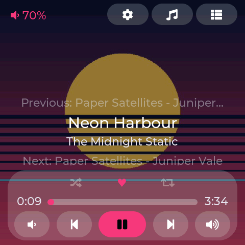<br><b>Now playing</b><br><sub>Album art, previous and next tracks, shuffle / like / repeat, progress and controls.</sub></td><td align="center" width="33%">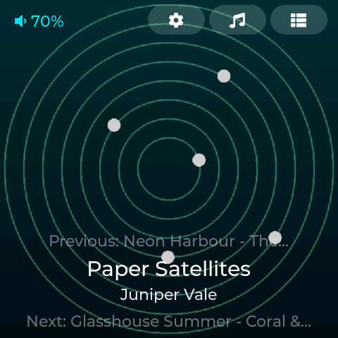<br><b>Controls hidden</b><br><sub>While music plays the controls fade and the text drops to the bottom.</sub></td><td align="center" width="33%">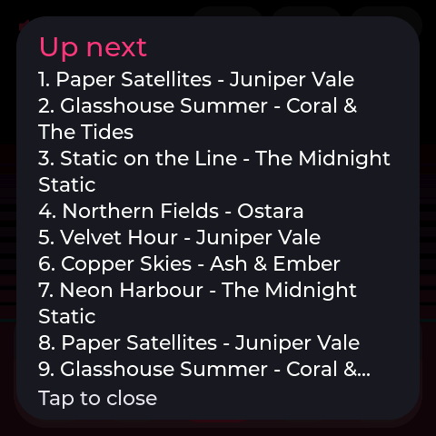<br><b>Up next</b><br><sub>Tap "Next" for the next ten queued tracks.</sub></td></tr>
<tr><td align="center" width="33%">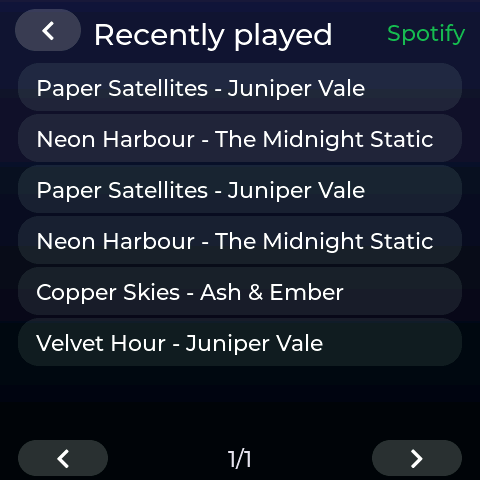<br><b>Recently played</b><br><sub>Tap "Previous"; tap a track to play it again.</sub></td><td align="center" width="33%">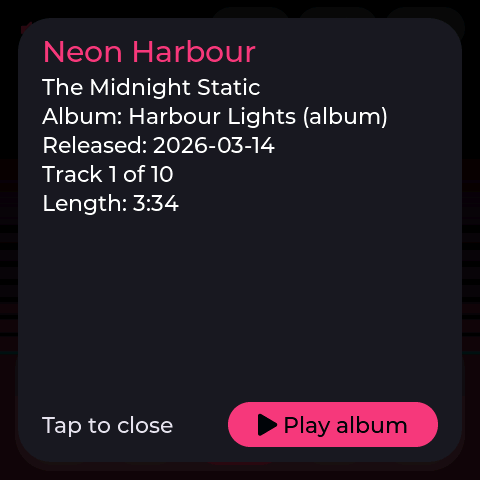<br><b>Track details</b><br><sub>Tap the title. Play album carries on from this point.</sub></td><td align="center" width="33%">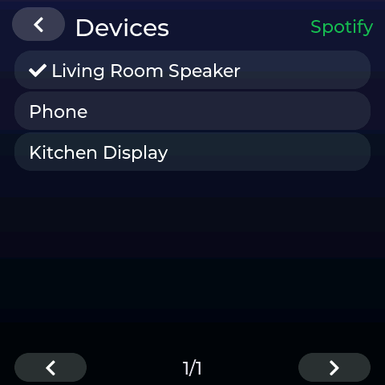<br><b>Devices</b><br><sub>Move playback to another Spotify Connect device.</sub></td></tr>
<tr><td align="center" width="33%">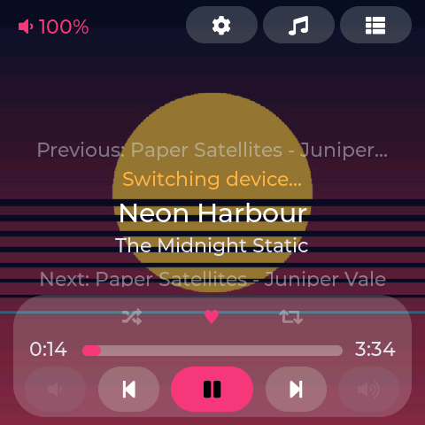<br><b>No remote volume</b><br><sub>On a phone the volume buttons grey out.</sub></td><td align="center" width="33%">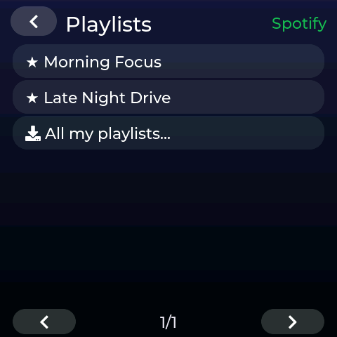<br><b>Playlists</b><br><sub>Pinned playlists first, then all of yours.</sub></td><td align="center" width="33%">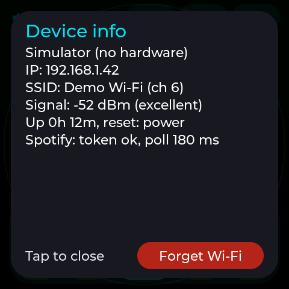<br><b>Device info</b><br><sub>Long press anywhere: network and status.</sub></td></tr>
<tr><td align="center" width="33%">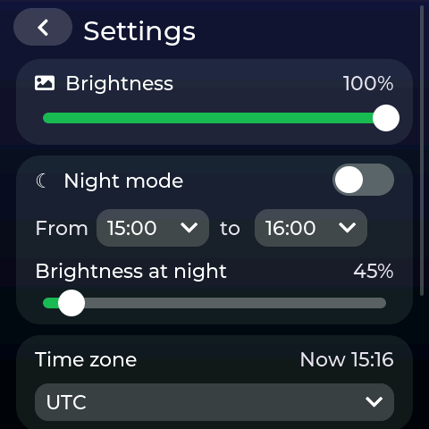<br><b>Settings</b><br><sub>Brightness and night mode (gear button).</sub></td><td align="center" width="33%">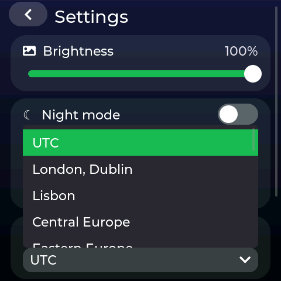<br><b>Time zone</b><br><sub>For night mode and the clock; summer time is automatic.</sub></td><td align="center" width="33%">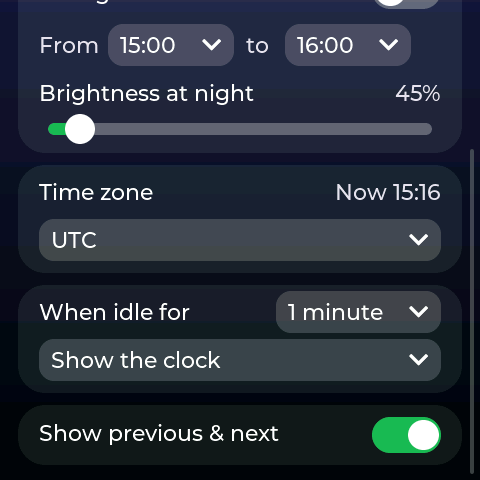<br><b>When idle</b><br><sub>Screen off or clock, after 1 minute to 1 hour; hide previous/next.</sub></td></tr>
<tr><td align="center" width="33%">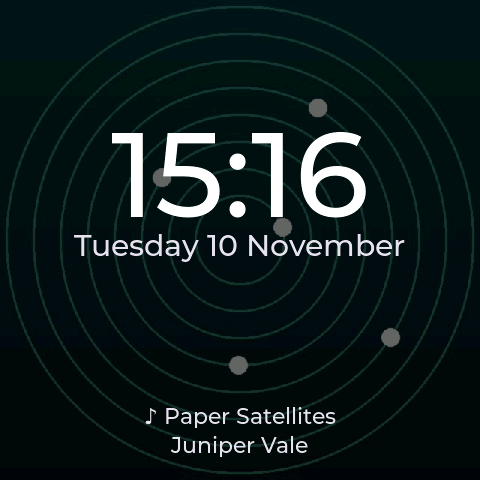<br><b>Idle clock</b><br><sub>Time, date and the current track over the album art.</sub></td></tr>
</table>

## Hardware

Designed for the **ESP32-2432S028R** (ESP32-WROOM-32, 4 MB flash, no PSRAM, 2.8" 320x240 ILI9341 display, XPT2046 resistive touch, USB-to-serial CH340).

The pin configuration is set with build flags in [platformio.ini](platformio.ini):

| Function | GPIO |
|---|---|
| TFT MOSI / MISO / SCLK / CS / DC | 13 / 12 / 14 / 15 / 2 |
| TFT backlight | 21 |
| Touch CLK / MOSI / MISO / CS / IRQ | 25 / 32 / 39 / 33 / 36 |

### ESP32-4848S040 (4.0" 480x480)

Also supported: the Guition **ESP32-4848S040** (ESP32-S3, 16 MB flash, 8 MB PSRAM, 4.0" 480x480 ST7701S RGB panel, GT911 capacitive touch). Build the `esp32-4848s040` PlatformIO environment, or flash `firmware-esp32-4848s040-merged.bin`. The same UI is scaled up 1.5x with larger fonts; the extra height of the square screen is used for a second row of controls (shuffle, like, repeat), the previous and next track lines and a two-line title. Album art is drawn 1:1 at 480x480 from the 640 px image (the default resolution on this board).

| Function | GPIO |
|---|---|
| ST7701S init SPI CS / SCK / SDA | 39 / 48 / 47 |
| RGB DE / VSYNC / HSYNC / PCLK | 18 / 17 / 16 / 21 |
| RGB R0-R4 / G0-G5 / B0-B4 | 11,12,13,14,0 / 8,20,3,46,9,10 / 4,5,6,7,15 |
| Backlight | 38 |
| Touch (GT911) SDA / SCL | 19 / 45 |

Differences from the CYD:

- There is no RGB LED, so the LED setting is hidden in the web interface.
- GPIO 0 (BOOT) is a data line of the display, so the BOOT-button reset is not available. Instead, **Forget Wi-Fi** in the device info popup (long press) also removes the web password.
- Firmware can be updated over Wi-Fi (two app slots in `default_16MB.csv`); see [Updating over Wi-Fi](#updating-over-wi-fi).
- Album art and large API responses are kept in PSRAM instead of flash files. A flash write briefly stalls the PSRAM the RGB panel is scanned from, which makes the picture jump, so the screen is also kept dark during a firmware update.
- The backlight is dimmed with 1 kHz PWM (the backlight driver does not respond to higher frequencies).
- The display is set up with `st7701_type9_init_operations` from the Arduino_GFX library. If the screen stays black or shows wrong colours, some panel batches need `st7701_type1_init_operations` instead (in [src/display.cpp](src/display.cpp)).

Board variants: some CYD boards use an ST7789 display instead (often the ones with two USB ports) and may need a different driver and display inversion (`ST7789_DRIVER`, `TFT_INVERSION_ON`). If colours look inverted on an ILI9341 board, add `-DTFT_INVERSION_ON` to `build_flags`. Touch orientation and calibration are in [src/display.cpp](src/display.cpp).

### 3D-printed case

The case in the photos is **[CYD Desk Buddy for Bambu Lab](https://makerworld.com/en/models/2787810-cyd-desk-buddy-for-bambu-lab-home-assistant#profileId-3099382)** by **[annaglyph](https://makerworld.com/en/@annaglyph)** on MakerWorld. It is a desk stand for the Cheap Yellow Display that leaves the touch screen and the BOOT button reachable.

All credit for the model goes to annaglyph. The model files are not part of this repository; download them from the MakerWorld page, where the model's own licence and print settings also apply. This project is not affiliated with the case designer.

## Install

### Option A: prebuilt firmware (no tools needed to build)

Download `firmware-merged.bin` from the latest [GitHub release](../../releases) (built automatically by the workflow in `.github/workflows/build.yml`). It is a single image containing bootloader, partition table and app, to be written at offset `0x0`.

#### Flash from the browser (nothing to install)

Use Chrome or Edge on a desktop computer (Web Serial is required) and connect the board over USB.

**esptool-js** (<https://espressif.github.io/esptool-js/>):

1. Press **Connect** and select the serial port of the board (CH340).
2. Set **Flash Address** to `0x0` and choose `firmware-merged.bin` as the file.
3. Press **Program** and wait until it reports 100%.
4. **Unplug the USB cable and plug it in again** to start the firmware (see the note below).

Important notes:

- The address must be `0x0`. The merged image already contains the bootloader (normally at `0x1000`), so flashing it at `0x1000` shifts everything and the screen stays black. esptool-js then warns `Image file at 0x1000 doesn't look like an image file`.
- On this board the automatic "Hard resetting via RTS pin" after flashing does not restart the chip, and the RST button on the back does not either. After flashing, power-cycle the board by reconnecting USB.
- If the board is not listed, install the CH340 USB driver. If flashing does not start, hold the BOOT button while pressing Connect.

#### Flash with esptool

With [esptool](https://github.com/espressif/esptool) (`pip install esptool`):

```bash
esptool.py --chip esp32 --baud 460800 write_flash 0x0 firmware-merged.bin
```

### Option B: build with PlatformIO

[PlatformIO](https://platformio.org/) is required to build from source.

```bash
pip install platformio
git clone <this repository>
cd "ESP32 Spotify Player"
python -m platformio run -e cyd -t upload             # ESP32-2432S028R (CYD)
python -m platformio run -e esp32-4848s040 -t upload  # ESP32-4848S040
```

PlatformIO downloads the toolchain and all libraries on the first build. Use `python -m platformio device monitor` for the serial console (115200 baud).

To create a single flashable image yourself:

```bash
python ~/.platformio/packages/tool-esptoolpy/esptool.py --chip esp32 merge_bin -o firmware-merged.bin \
  --flash_mode dio --flash_freq 40m --flash_size 4MB \
  0x1000 .pio/build/cyd/bootloader.bin \
  0x8000 .pio/build/cyd/partitions.bin \
  0xe000 ~/.platformio/packages/framework-arduinoespressif32/tools/partitions/boot_app0.bin \
  0x10000 .pio/build/cyd/firmware.bin
```

For the ESP32-4848S040 use `--chip esp32s3 merge_bin --flash_mode keep --flash_freq keep --flash_size 16MB` with the bootloader at `0x0` and the files from `.pio/build/esp32-4848s040/` (see the workflow for the full command); flash it with `esptool.py --chip esp32s3 write_flash 0x0 firmware-esp32-4848s040-merged.bin`.

The CYD firmware uses the `huge_app.csv` partition table (3 MB app, ~0.9 MB LittleFS, no OTA).

### Updating over Wi-Fi

On the ESP32-4848S040, once a firmware with this feature is installed, later versions can be installed from the web interface:

1. Open `http://<device-ip>` and go to the **Firmware** tab. It shows the installed build date.
2. Choose the **app-only** file: `firmware-esp32-4848s040-update.bin` from a release, or `.pio/build/esp32-4848s040/firmware.bin` from your own build. The merged file (`...-merged.bin`) is for USB flashing only and is refused.
3. Press **Upload & install**. The screen stays dark while the update is written; the device then restarts into the new firmware. Settings, the Spotify login and pins are kept.

Files for another chip or merged images are rejected, the web password (if set) is checked, and an upload that is cut off is cancelled so the device keeps running the old firmware. From the command line: `curl -F firmware=@firmware.bin http://<device-ip>/update`.

## Configuration

### 1. Connect to Wi-Fi

1. On first boot the device starts an access point named **`Spotify-Player-Setup`** and shows the setup instructions and its IP address on screen.
2. Connect your phone or computer to that network and open `http://192.168.4.1`.
3. On the **Wi-Fi** tab enter your network name and password. The device restarts and shows its new IP address on screen.

If the saved network cannot be reached, the device falls back to the access point. If nobody connects to it for 5 minutes it restarts and tries the saved network again.

#### Multiple networks and changing Wi-Fi

The device remembers up to 8 networks. Every network you add (Wi-Fi tab, in setup mode or when connected) is saved. At boot it scans for the saved networks, tries the ones that are in range in order of last use, and checks that the connection really has internet access. A network that connects but has no internet (for example a guest Wi-Fi with a captive portal) is skipped in favour of the next one; if no saved network has internet it stays on the best one so you can still reach the settings.

Manage the saved networks on the **Wi-Fi** tab of the web interface, in setup mode and when connected: each network can be removed, and the connected one shows **Forget & disconnect**.

If the current network has no working internet, the screen shows "No internet. Long-press the screen to forget this Wi-Fi." and the device also starts the `Spotify-Player-Setup` access point next to the normal connection after about 2 minutes. To leave the network you can:

- **On the device:** long-press the screen to open the device info popup and tap **Forget Wi-Fi** twice (the second tap confirms). This forgets only the connected network; the device then restarts and joins another saved network, or starts setup mode if there is none.
- **BOOT button (CYD only):** hold the BOOT button on the back of the board for 3 seconds. This forgets the connected network (as above) **and removes the web password**, so it is also the way back in when you forgot the password.
- **Web interface:** on the Wi-Fi tab use **Forget & disconnect** next to the connected network, or **Forget all & restart in setup mode**.

Forgetting a network removes only Wi-Fi credentials. Your Spotify login, pins and settings are kept.

#### Protecting the web interface with a password

Out of the box the web interface has no password. To add one, open the **Security** tab, enter a password (4-64 characters) twice and press **Set password**. The browser then asks for a login: the username can be anything (for example `admin`), the password is the one you set. Use the same tab to change or remove it.

- The password protects every page and endpoint, including setup mode on the `Spotify-Player-Setup` access point.
- It is stored as a salted SHA-256 hash, never as plain text. After a burst of wrong attempts the device temporarily answers with "Too many attempts" for 30 seconds.
- Forgot it? Hold the BOOT button for 3 seconds (this also forgets the connected Wi-Fi network).
- The login uses HTTP Basic authentication over plain HTTP, so the password is sent unencrypted on your network. It keeps casual users and other devices out; it does not protect against someone sniffing your Wi-Fi traffic.

### 2. Create a Spotify app

1. Go to the [Spotify Developer Dashboard](https://developer.spotify.com/dashboard) and create an app (the Web API is the only API needed).
2. Add this exact redirect URI: `http://127.0.0.1:8080/callback`
3. Copy the **Client ID**. No client secret is used.

Apps in Spotify's development mode are limited to a small number of allowed users; add your own Spotify account under "User Management" in the dashboard.

### 3. Log in to Spotify

Open the device's web interface on your home network (`http://<device-ip>`), go to the **Spotify** tab and:

1. Enter the Client ID (it is remembered for later re-authorisation) and press **1. Login to Spotify**.
2. Approve the access in the Spotify page. The browser then fails to open `127.0.0.1:8080`; this is expected.
3. Copy the full URL from the address bar, paste it in the field and press **2. Save Spotify Config**.

The PKCE challenge is generated on the ESP32 and only the refresh token is stored (in flash). Requested scopes: `user-read-playback-state`, `user-modify-playback-state`, `playlist-read-private`, `user-library-read` and `user-library-modify` (Like), `user-read-recently-played` (previous track and recently played). After updating from an older version that lacked a scope, simply log in again; until then the features that need it say so on screen.

### 4. Optional settings

- **Album art resolution** (Spotify tab): 64, 300 or 640 px (default 300 on the CYD, 640 on the ESP32-4848S040). On the CYD images are downloaded to a temporary flash file, decoded, and deleted again; the ESP32-4848S040 keeps them in PSRAM.
- **Pinned playlists** (Playlists tab): search "My playlists", search Spotify, or paste a playlist URL or ID. Pinned playlists appear first on the display and play without any lookup.
- **Brightness, night mode, time zone, idle behaviour** and **previous/next lines**: on the device's **Settings** screen (gear button). Set the time zone first; night mode and the clock use it.

## Using the device

| Action | Result |
|---|---|
| Tap play / prev / next / volume buttons | Control playback on the active device |
| Swipe left / right | Next / previous track |
| Tap the progress bar | Seek to that position |
| Tap shuffle / heart / repeat (ESP32-4848S040) | Toggle shuffle, like or unlike the track, cycle repeat (off, context, track) |
| Tap anywhere while the controls are hidden | Show the controls |
| Tap the speaker icon (top right) | Choose the playback device |
| Tap the list icon (top right) | Open playlists (pinned first, then "Load more") |
| Tap the gear icon (top) | Settings |
| Tap title or artist | Track details, with **Play album** |
| Tap "Next: ..." / "Previous: ..." (ESP32-4848S040) | Up next queue / recently played list |
| Tap the clock | Back to the player |
| Long press (0.7 s) anywhere else | Device and network info |
| Tap a popup | Close it |

## Limitations

- Spotify no longer returns its own algorithmic and editorial playlists (Daily Mix, radio, Discover Weekly, ...) to development-mode apps. They do not appear in lists. You can try pinning one by ID, but loading its name or playing it is not guaranteed to work.
- The Web API has no composer or credits data, and popularity and label fields were removed in 2026.
- Since February 2026 development-mode apps use the generic `/me/library` endpoints for Liked Songs; the old `/me/tracks` endpoints answer 403. Recommendations, audio analysis and Spotify's Canvas videos are not available to these apps.
- Many devices (most phones, some speakers) do not allow remote volume control; the volume buttons are then greyed out. A device that claims support but still refuses is detected on the first press.
- The "Previous" line comes from Spotify's recently played list, which only includes a track once it has played for a while, so it can lag a few seconds behind a skip.
- Memory is tight on the ESP32 without PSRAM. The firmware keeps a single TLS connection to Spotify, retries failed connections, and streams large responses through temporary flash files. If you see `connection refused` in the debug log, it was a TLS memory allocation failure that is retried automatically.
- TLS certificates are **not verified** (`setInsecure()`). Anyone able to intercept your traffic could read the access token. Pin the Spotify root certificate if you need protection against that.
- The setup access point is open, and the web interface has no password until you set one on the **Security** tab. Even with a password, the connection is plain HTTP (no encryption), so use it on a network you trust.

## Troubleshooting

- Black screen after flashing: check that the merged image was written at `0x0` (not `0x1000`), then unplug and replug the USB cable. A reset via RTS or the RST button may not restart this board.
- Open the **Debug** tab, enable *Verbose logging* and use *Copy* to share the log. Entries show HTTP status codes, timing and free heap.
- After an unexpected restart the log starts with the reset reason (panic, watchdog, brownout). A weak USB supply can cause brownouts.
- Nothing playing or "No active device": start playback once in the Spotify app, then pick the device from the device list.
- Insufficient permission (HTTP 403, "Insufficient client scope") when loading playlists, liking a track or opening recently played: log in again on the Spotify tab to grant the newer permissions.
- Clock shows `--:--` or night mode never starts: the time has not been fetched yet (needs internet), or the time zone is wrong (Settings).
- Locked out of the web interface: use any username with the password. If you forgot it, hold the BOOT button for 3 seconds to remove the password (this also forgets the connected Wi-Fi network).

## Desktop simulator (for demos)

The player UI also runs on a Mac (or Linux) in a 480x480 window, using the real [src/ui.cpp](src/ui.cpp) with fake Spotify data. That makes it easy to record a clean demo video: no glare, any frame rate, and a repeatable "playlist".

```bash
brew install sdl2                        # Linux: sudo apt install libsdl2-dev
pio run -e simulator -t exec             # build and start; close the window to quit
```

- The mouse is your finger: click to tap, drag to swipe or move a slider, hold for a long press.
- Everything works as on the ESP32-4848S040: controls, swipes, shuffle/like/repeat, previous/next, queue and recently played, devices (the "Phone" device shows the greyed-out volume buttons), playlists, track details with Play album, Settings (brightness and night mode dim the window), and the idle clock in your Mac's time zone. Settings are kept only until you quit.
- **Recording:** press Cmd+Shift+5 on macOS, choose *Record Selected Window* and click the simulator. For a sharper video on a large screen start it with `SIM_ZOOM=2` (or 3).
- **Options** (environment variables): `SIM_ZOOM=2` window scale; `SIM_IDLE_CLOCK=1 SIM_IDLE_MINUTES=1` show the clock after a minute; `SIM_SNAPSHOT=shot.bmp` (with `SIM_SNAPSHOT_MS=3000`) saves the screen to a file and quits, for stills.
- **Album art:** the covers in `sim/art/` are original abstract images made by `python3 sim/make_demo_art.py`. Replace `1.jpg` to `5.jpg` with your own (baseline JPEG, ideally 640x640) to change them; the demo tracks are listed in [sim/src/fake_spotify.cpp](sim/src/fake_spotify.cpp).

- **Screenshots:** `python3 sim/make_screenshots.py` recreates the images in `images/esp32-4848s040/` (shown above) from moments in the scripted demo.
- **Demo video:** `python3 sim/make_demo_video.py demo.mp4` (needs ffmpeg and Pillow) records a scripted tour of every feature with captions, straight from the simulator at 30 fps. The script is in [sim/src/demo.cpp](sim/src/demo.cpp): timed taps, swipes and drags at screen coordinates, plus the caption for each part.

The `simulator` environment is not in `default_envs`, so `pio run` and the GitHub build only build the two boards. The simulator code is in `sim/`: small stand-ins for the Arduino core and the firmware modules the UI talks to, an SDL2 display, and the fake Spotify service.

## Project layout

```
platformio.ini        Board, libraries, display pin build flags
include/lv_conf.h     LVGL configuration
src/main.cpp          State machine (setup AP -> Wi-Fi -> Spotify ready)
src/spotify.*         Spotify Web API client (runs in its own task)
src/ui.*              LVGL screens, popups, lists, album art
src/web_portal.*      Web interface and JSON endpoints
src/config.*          Settings and pinned playlists (LittleFS)
src/app_log.*         In-RAM log shown in the browser
src/display.*         TFT / RGB panel, touch and backlight drivers for LVGL
src/board.h           Per-board constants (screen size, fonts, features)
src/clock_time.*      Internet time and time zones
src/fonts/            Generated LVGL fonts
sim/                  Desktop simulator (SDL2) with fake Spotify data
```

The fonts in `src/fonts` are generated with `lv_font_conv` from Montserrat and DejaVu Sans (see the header of each file for the exact command). The `font_clock_*` fonts contain only digits, the colon and the dash, for the idle clock.

## Credits and licence

Built with [LVGL](https://lvgl.io/), [TFT_eSPI](https://github.com/Bodmer/TFT_eSPI), [GFX Library for Arduino](https://github.com/moononournation/Arduino_GFX), [TJpg_Decoder](https://github.com/Bodmer/TJpg_Decoder), [ArduinoJson](https://arduinojson.org/), [ESPAsyncWebServer](https://github.com/ESP32Async/ESPAsyncWebServer) and [XPT2046_Touchscreen](https://github.com/PaulStoffregen/XPT2046_Touchscreen).

Case: [CYD Desk Buddy for Bambu Lab](https://makerworld.com/en/models/2787810-cyd-desk-buddy-for-bambu-lab-home-assistant#profileId-3099382) by [annaglyph](https://makerworld.com/en/@annaglyph).

Released under the GNU General Public License v3.0, see [LICENSE](LICENSE).
